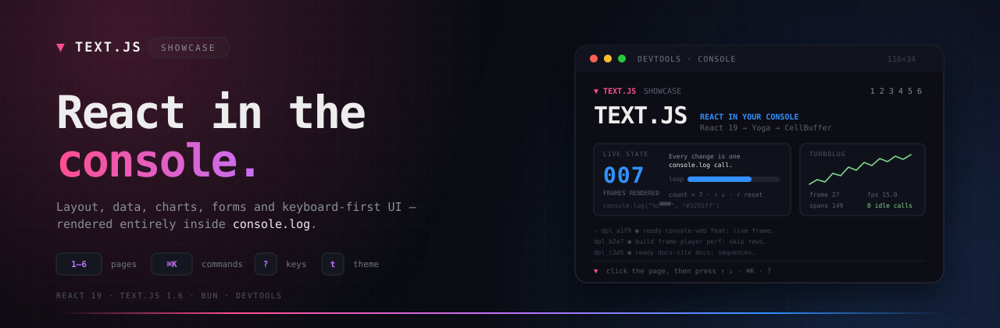
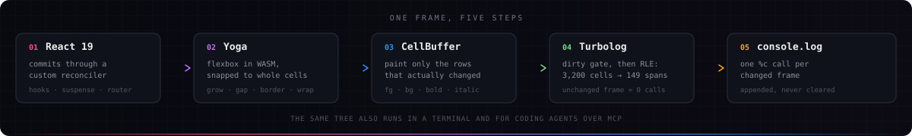

<div align="center">
  
</div>

<div align="center">

**A six-page playground for [Text.js](https://textjs.org): layout, data, charts, forms, and keyboard-first UI — rendered entirely inside `console.log`.**

[](https://textjs.org)
[](https://react.dev)
[](https://bun.sh)
[](#-quick-start)
[](#-verification)

</div>

---

## ⚡ Quick start

```bash
git clone git@github.com:xeronith/textjs-showcase.git
cd textjs-showcase
bun install
bun dev
```

Open **http://localhost:3000**, open the **DevTools console**, and **click the page** so it can capture keys.

> **Heads up:** turn **Preserve log** off in the console settings. Text.js appends one message per changed frame.

<br />

## 🕹️ Try this

| Do this | See this |
| --- | --- |
| `1` then `↑ ↑ ↓ r` | A live counter: every keystroke is one `console.log` frame |
| `2` then `Tab` `→ →` | A resizable `SplitPane`, nested boxes, spinners, a scrollbox |
| `3` then `s`, `Space`, `↓` | Sort a virtualized table, multi-select rows, inspect a deployment |
| `4` then `f` | Fetch `GET /api/metrics` and watch a live two-series chart |
| `5` then `ctrl+s` | Save the form, then open **Delete workspace…** to see a focus trap |
| `6` then `g g`, `n`, `j` | Key sequences, a step counter, and the live key inspector |
| `ctrl+k` | Fuzzy command palette over pages, actions, and keybindings |
| `?` | Every active shortcut, grouped and discoverable |
| `t` | Cycle Geist Dark → Tokyo Night → OpenCode Dark → Amber CRT → Geist Light |

<br />

## 🗺️ The tour

| Page | Key | What it shows |
| :--- | :---: | :--- |
| **Overview** | `1` | Live React state, ASCII lettering, gradients, sparklines, Turbolog telemetry |
| **Layout** | `2` | `Box`, `Stack`, `Grid`, `SplitPane`, `ScrollBox`, `Center`, badges, spinners, progress bars |
| **Data** | `3` | Sortable multi-select `Table`, virtualized `Tree`, `Markdown`, highlighted `Code`, `Diff`, clipboard |
| **Charts** | `4` | Animated `LineChart`, `BarChart`, `Sparkline`, `ProgressBar`, and a route handler fetch |
| **Forms** | `5` | `Input`, `Textarea`, `Select`, `Switch`, `Checkbox`, `RadioGroup`, `Slider`, `Confirm`, toasts |
| **Keyboard** | `6` | `useKeymap` sequences, `useInput`, focus manager, active-binding registry, live key inspector |

The shell adds a command palette, shortcut overlay, five themes, toasts, a not-found route, and a responsive header that collapses at narrow widths.

<br />

## 🧠 How a frame is made

<div align="center">
  
</div>

<div align="center">
  <sub>A commit that changes no cells never reaches the console.</sub>
</div>

<br />

- **React 19** — concurrent rendering, Suspense, error boundaries
- **Yoga** — flexbox in WebAssembly, snapped to integer cells
- **CellBuffer** — only damaged rows repaint
- **Turbolog** — RLE-encodes the frame into `%c` spans, appends one `console.log`
- **App Router** — layouts, dynamic params, route handlers, deep links
- **Terminal + MCP** — the same tree runs in truecolor ANSI and for coding agents

<br />

## 🧩 Project map

```text
app/
  layout.tsx              shell · nav · palette · themes · toasts
  page.tsx                overview
  primitives/page.tsx     layout primitives
  data/page.tsx           table / tree / markdown / code / diff
  charts/page.tsx         live charts + /api/metrics fetch
  forms/page.tsx          inputs, dialog, feedback
  keyboard/page.tsx       keymaps, focus, live key inspector
  api/metrics/route.ts    route handler
components/ui.tsx         shared panels, headers, cards
lib/showcase.ts           demo data and deterministic generators
scripts/smoke.tsx         headless render + key-press checks
text.config.ts            viewport, title, focus pad hints
```

<br />

## ✅ Verification

```bash
bun run typecheck   # strict TypeScript
bun run test        # headless render + key presses for every page
bun run build       # six static console routes + one route handler
```

The app was also driven end-to-end in Chrome: palette, themes, help overlay, routing, form save, table selection, and the route-handler fetch all verified against the real console renderer.

<br />

## 📚 Learn Text.js

- [Documentation](https://textjs.org/docs)
- [Components](https://textjs.org/docs/components-layout)
- [Keyboard and keymaps](https://textjs.org/docs/keyboard)
- [Terminal output](https://textjs.org/docs/terminal)
- [MCP for coding agents](https://textjs.org/docs/mcp)
- [The free 10-chapter course](https://textjs.org/learn)

---

<div align="center">
  <sub>Built with <a href="https://textjs.org">Text.js</a> · React 19 · Bun</sub>
</div>
